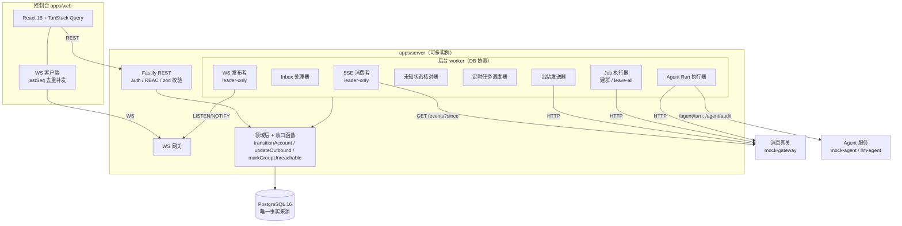
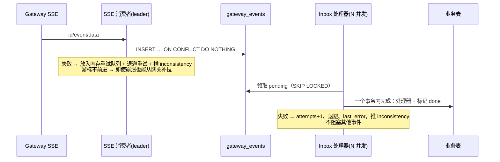
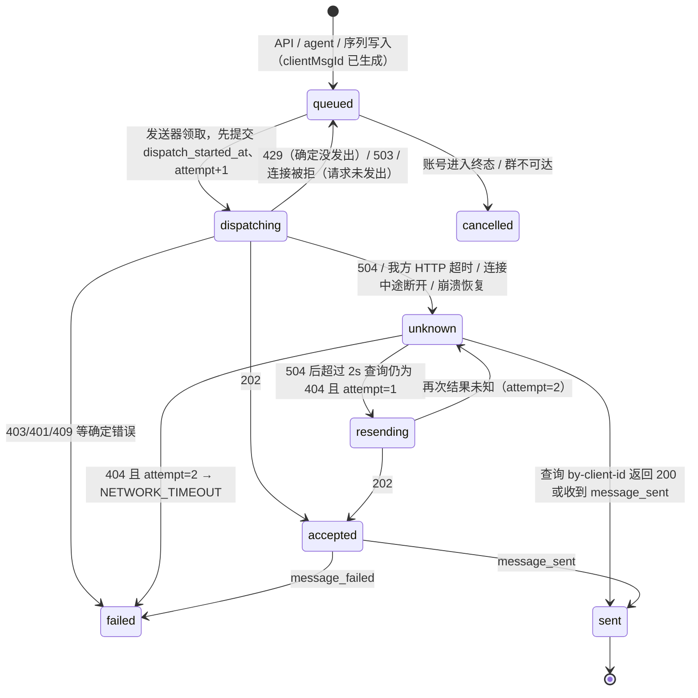
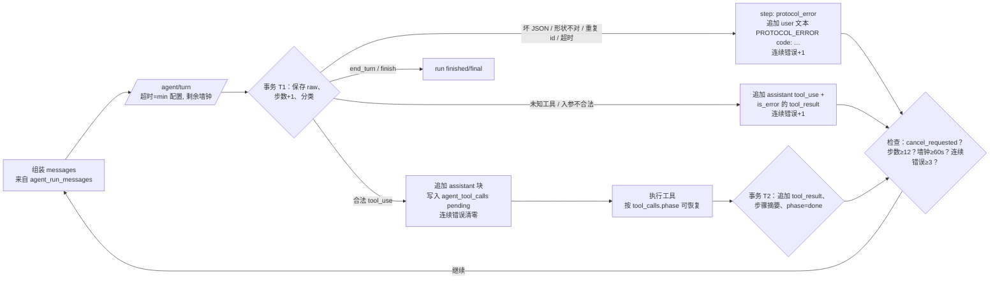

# 多账号群组消息平台 — 技术架构设计

> 本文是实现前的架构设计。目标：先把"可靠性骨架"定对，让 A 组的每一条要求都能从骨架里自然推出，而不是逐条打补丁。

---

## 0. 需求本质与核心难点

题目表面是 CRUD + 控制台，实际考的是**不可靠外部依赖下的分布式一致性**。把全部要求归纳后，真正决定成败的是这 8 个难点：

| # | 难点 | 来源 | 本设计的应对 |
|---|---|---|---|
| D1 | 任意时刻崩溃重启，所有行为仍成立 | 总则 | 所有状态与"待办"只存在 PG；进程无关键内存状态；每个副作用前先落库（write-ahead） |
| D2 | 事件 at-least-once + 乱序 ≤1s + 补投任意旧消息 + 断线补拉 | 2.1 事件流 | Inbox 表（`event_id` 主键去重）+ 带安全回退的游标 + **与顺序无关的事件处理器** |
| D3 | send 结果未知（504 / 我方超时 / 崩溃在请求中），网关不去重 | A2 | 出站状态机：确认"没发出"之前绝不重发；`clientMsgId` 由我方预生成并先落库 |
| D4 | 多来源（事件/同步错误/操作员）触发同一后果，要么全生效要么全不生效 | A1 | **收口函数（chokepoint）**：`transitionAccount` / `updateOutbound` / `markGroupUnreachable`，后果在同一事务里完成 |
| D5 | 并发 & 多实例下的互斥 | A1/A5/B1 | CAS 条件更新、部分唯一索引、行锁 `NOWAIT`、租约（lease） |
| D6 | Agent run 在任意一步中断后续跑，不重复外部效果 | A5.8 | 每步拆成持久化的子阶段 + 工具效果日志（effect journal） |
| D7 | 推给前端的事件必须对应已提交状态、seq 单调、可补发 | A1/A4/B4 | 事务性 outbox + **单发布者提交后分配 seq**（规避 bigserial 提交乱序陷阱） |
| D8 | 时间语义：10s 超时、60s 墙钟（停机不计）、序列排期、限流到期 | A2/A5/B1 | 持久化定时任务表 + 可注入时钟 + 墙钟分段累计 |

---

## 1. 总体架构



**进程模型**：只有一种服务进程，同时跑 API 与所有 worker；可以起 N 个实例。

- 需要单例的循环（SSE 消费、WS seq 发布）用 `pg_try_advisory_lock` 选主。持锁连接断开时锁自动释放，其他实例接管。
- 其余 worker 用 `FOR UPDATE SKIP LOCKED` 或租约领取工作，天然支持多实例。
- **没有任何"只在内存里"的待办**：进程随时可以被 `kill -9`。

---

## 2. 技术选型

| 层 | 选择 | 理由 |
|---|---|---|
| 仓库 | pnpm workspaces 单仓库 | 前后端、mock、共享包一起版本化 |
| HTTP | Fastify 5 | 性能好、插件化的错误处理与 hook，内置 requestId |
| DB 访问 | `pg` + 手写 SQL（薄封装 `withTx`） | 本题大量依赖 `FOR UPDATE NOWAIT`、`SKIP LOCKED`、部分唯一索引、条件 UPDATE，手写 SQL 最直观可控 |
| 迁移 | 自研极简 runner + 纯 `.sql` 文件 | 可重复执行（advisory lock + `schema_migrations`），便于做"schema 落后拒绝启动" |
| 校验 | zod（API 入参）、ajv（Agent 工具 input_schema，一份 JSON Schema 同时发给 Agent 并用于校验） | 保证"发出去的 schema"与"校验用的 schema"是同一份 |
| 鉴权 | `jose`（JWT）+ argon2/bcrypt | |
| WS | `ws`（挂在 Fastify 的 server 上） | |
| 日志 | pino | |
| 测试 | Vitest（单元 / 集成）、Playwright（C3） | |
| 前端 | Vite + React 18 + TS + React Router + TanStack Query + zustand + antd | 服务端状态交给 Query，WS 事件直接改 Query 缓存 |
| 运行 | docker-compose：postgres:16、mock-gateway、mock-agent、server、web | 一条命令起全套 |

环境变量：`PORT`、`DATABASE_URL`、`GATEWAY_URL`、`AGENT_URL`（题目要求），另加 `JWT_SECRET`、`INSTANCE_ID`、`AGENT_TURN_TIMEOUT_MS=12000`、`AGENT_RUN_WALL_MS=60000`、`JOIN_TIMEOUT_MS=10000`、`MEDIA_RETENTION_DAYS=30` 等。所有时长都可配，测试时可以缩短。

---

## 3. 可靠性基石（全局设计原则）

1. **PG 是唯一事实来源**。内存只做缓存和唤醒信号，丢了不影响正确性。
2. **Write-ahead**：对外产生副作用之前，先在一个已提交的事务里记下"意图"。例如出站消息先写 `queued` 并设置 `dispatch_started_at`；kick 先把工具执行记录标为 `executing`；断开连接先写一个 `gateway_disconnect` 任务。
3. **收口函数**：跨模块的后果只在少数函数里实现。任何来源都调同一个函数，在同一事务里完成全部后果，因此"从任何来源进入终态结果都一样，要么全生效要么全不生效"是由结构保证的。
   - `transitionAccount(tx, accountId, expectedFrom | ANY_NON_TERMINAL, to, source)`
   - `updateOutbound(tx, messageId, patch)`：负责把状态联动到序列步骤、唤醒 agent 等待者、写 WS 事件
   - `markGroupUnreachable(tx, groupId)`
4. **状态只前进**：所有状态更新都是带 `WHERE status IN (...)` 或按状态排名比较的条件 UPDATE，乱序、重复的事件不会让状态回退。
5. **幂等 + 与顺序无关**：每个事件处理器都满足"执行多次 = 执行一次"，并且与到达顺序无关（见 5.1）。这样 inbox 可以并发处理，也可以任意重放。
6. **事务内写 WS outbox**：WS 事件只在业务事务提交后才可能被推送（D7）。
7. **可注入时钟与崩溃点**：`clock.now()` 可替换；代码里在关键位置埋 `crashpoint('outbound.after_mark_dispatching')`，测试时可以设置 `CRASH_AT=...` 让进程在该点 `process.exit`，用来验证重启语义。

---

## 4. 数据模型

> 只列关键列与约束，完整 DDL 在 `apps/server/migrations/*.sql`。

### 4.1 基础与鉴权

```sql
schema_migrations(version int primary key, applied_at timestamptz)
users(id, username unique, password_hash, role check (role in ('admin','viewer')))
sessions(id uuid pk, user_id, created_at, revoked_at)
refresh_tokens(id, session_id, token_hash unique, created_at, used_at, replaced_by)
revoked_access_tokens(jti pk, expires_at)          -- logout 使用，过期后清理
```

### 4.2 账号、群、成员

```sql
accounts(
  id text pk,                          -- seed 预置：acc_01 … acc_08
  status text not null,                -- idle|online|rate_limited|disconnected|suspended|session_expired
  platform_user_id text unique,
  rate_limited_until timestamptz,
  updated_at timestamptz)

groups(
  id uuid pk, gateway_group_id text unique,
  status text,                         -- active|unreachable|left
  creator_account_id text, agent_enabled bool default false, auto_kick_enabled bool default false)

group_members(
  group_id, platform_user_id,          -- 包含外部用户
  account_id text null,                -- 服务账号才有
  role text,                           -- creator|admin|member
  present bool,                        -- 软状态
  state_event_id bigint,               -- 最近一次改变 present 的网关事件 id（按事件 id 实现"后发生者胜出"）
  primary key (group_id, platform_user_id))
```

### 4.3 网关事件收件箱

```sql
gateway_events(
  event_id bigint primary key,         -- 天然去重
  type text, raw bytea,                -- 原始帧按字节保存，避免 \u0000 等字符导致 jsonb/text 写入失败
  received_at timestamptz,
  status text,                         -- pending|done|failed
  attempts int, last_error text, next_attempt_at timestamptz)
kv(key text pk, value jsonb)            -- event_cursor 等
```

### 4.4 消息（入站和出站共用一张表 → "一条消息只有一行"）

```sql
messages(
  id bigserial pk,                     -- 稳定行 id，也用作分页并列排序键
  group_id uuid not null,
  msg_id text,                         -- 网关 msgId（出站在 sent 之前为 null）
  client_msg_id text unique,           -- 仅出站；由我方生成
  is_own bool not null,
  echo_pending bool default false,     -- 自己消息的回流先于 message_sent 到达时的临时行（列表中隐藏，见 5.2）
  sender_platform_user_id text, account_id text,
  text text, media_url text, local_file_path text,
  created_at timestamptz,              -- 受理时刻
  sent_at timestamptz,                 -- 网关 sentAt
  sort_ts timestamptz not null,        -- = coalesce(sent_at, created_at)，由 updateOutbound 维护
  -- 出站状态
  delivery_status text,                -- queued|accepted|sent|failed|unknown|cancelled（对外）
  phase text,                          -- 内部更细的阶段：queued|dispatching|accepted|unknown|resending|sent|failed|cancelled
  fail_code text, attempt smallint default 0,
  dispatch_started_at timestamptz, unknown_since timestamptz, lease_owner text,
  -- 来源
  source text,                         -- operator|agent|sequence
  agent_run_id uuid, idempotency_key text, sequence_run_step_id bigint)

unique (group_id, msg_id) where msg_id is not null
unique (agent_run_id, idempotency_key) where agent_run_id is not null
index (group_id, sort_ts desc, id desc)                 -- 时间线 keyset 分页
index (account_id, id) where phase in ('queued','dispatching','unknown','resending')  -- 每账号 FIFO
```

### 4.5 Job、定时任务、WS outbox

```sql
jobs(id uuid pk, type text, status text, input jsonb, state jsonb, errors jsonb default '[]',
     lease_owner text, lease_until timestamptz)
scheduled_tasks(id bigserial, kind text, ref text, run_at timestamptz, lease_owner, lease_until,
                unique (kind, ref))    -- 例如 ('rate_limit_expiry','acc_01')、('gateway_disconnect','acc_02')
ws_outbox(id bigserial pk, seq bigint unique null, type text, payload jsonb, created_at)
```

### 4.6 Agent

```sql
agent_runs(
  id uuid pk, group_id uuid, status text, end_reason text, summary text,
  trigger_messages jsonb,
  step_count int, consecutive_protocol_errors int,
  elapsed_ms int, active_since timestamptz,        -- 墙钟分段累计（停机不计）
  cancel_requested bool, lease_owner text, lease_until timestamptz, created_at, finished_at)
unique (group_id) where status = 'running'         -- 每群至多一个 running（多实例下同样成立）

agent_run_messages(run_id, idx int, role text, content jsonb, primary key(run_id, idx))  -- 只追加的对话记录
agent_run_steps(run_id, seq int, kind text, tool_use_id text, name text, input jsonb,
                result_summary text, is_error bool, error_code text, audit_verdict text,
                raw_response text /* ≤2KB */, primary key(run_id, seq))
unique (run_id, tool_use_id) where tool_use_id is not null   -- 检测重复的 tool_use.id

agent_tool_calls(                      -- 工具效果日志（恢复的依据）
  run_id, tool_use_id, name, input jsonb,
  phase text,                          -- pending|auditing|executing|done
  audit_attempts smallint, audit_verdict text,
  outbound_message_id bigint, exec_started_at timestamptz,
  result jsonb, primary key(run_id, tool_use_id))

agent_triggers(msg_row_id bigint pk, group_id uuid, run_id uuid null, discarded bool)
```

### 4.7 序列

```sql
sequences(id uuid pk, name text, steps jsonb)
sequence_runs(id uuid pk, group_id uuid, sequence_id uuid, status text, current_step_index int,
              vars jsonb, step_vars jsonb, created_at)
unique (group_id) where status = 'running'
sequence_run_steps(id bigserial, run_id, index int, status text, account_role text,
                   text_template text, delay_seconds int, resolved_vars jsonb, var_sources jsonb,
                   scheduled_at timestamptz, sent_at timestamptz, client_msg_id text, message_id bigint)
```

### 4.8 迁移与版本门禁

- `pnpm migrate`：先获取 `pg_advisory_lock(迁移锁)`，再按顺序执行尚未应用的迁移文件，每个文件一个事务。可以反复执行。
- 代码常量 `EXPECTED_SCHEMA_VERSION`（等于迁移文件数）。启动时 `max(version) < EXPECTED` 就打印错误并 `exit(1)`。`/api/health` 返回这个值。
- 在 compose 里，server 容器的启动命令为 `migrate && start`。

---

## 5. 核心流程设计

### 5.1 网关事件接入（D2）



**游标（续传点）**：

- 网关保留全部历史，所以**网关本身就是持久日志**。我方只要保证"游标不越过尚未落库的事件"，就不会丢事件。
- 消费者在内存里维护"已收到但还没落库"的 id 集合。持久化的游标取 `min(未落库 id) - 1` 和"`received_at` 早于 2 秒前的已落库最大 id"两者中较小的那个。这 2 秒的回退覆盖了 1 秒的乱序窗口。
- 重连时带 `since=游标`，重复拉回来的事件由主键吸收。服务停机期间的事件因此在重启后全部补齐。

**"数据库写入失败"的两层兜底**：

1. 原始事件落库失败（例如数据库短暂不可用）：事件留在内存队列里重试，游标不前进，所以进程崩溃了也能从网关补拉，内容不会丢；同时推 `inconsistency`。
2. 业务处理失败（例如某条消息文本含 `\u0000`，PG 的 text 类型拒收）：原始事件已经按 bytea 保存，不会丢；该事件标记为 `failed` 并按退避重试（处理器对 `\u0000` 做清洗，数据被修改时也推 `inconsistency`）；重试若干次后进入"死信"状态，在控制台可见；其他事件照常处理。

**与顺序无关的处理器**（这是可以并发处理、可以任意重放的前提）：

| 事件 | 处理 | 为何与顺序无关 |
|---|---|---|
| `message` | 按 `(group_id, msg_id)` upsert；判断 isOwn；非自己消息且群 `agent_enabled` → 插入 `agent_triggers` | 唯一约束去重；按 `sentAt` 排序展示 |
| `message_sent` | `updateOutbound`：阶段提升到 `sent`，写入 msgId 和 sentAt，合并回流临时行 | 状态只前进 |
| `message_failed` | `updateOutbound → failed`（按 code 执行后果） | 状态只前进；`sent` 优先 |
| `member_joined` / `member_left` | `UPDATE … SET present = ? WHERE state_event_id < :eventId`（不存在则插入） | 按事件 id 实现后发生者胜出 |
| `account_status` | `transitionAccount(ANY_NON_TERMINAL → 终态)` | 终态是吸收态；重复进入静默忽略 |

处理器遇到唯一约束冲突或序列化冲突时整个事务重试。例如回流消息和 `message_sent` 并发处理的情况。

### 5.2 出站发送状态机（D3，A2 的核心）



要点：

- **不会出现"网关发了但库里没有"**：请求发出前，`queued` 行和 `dispatch_started_at` 已经提交。
- **不会出现"一条记录在网关对应多条消息"**：只在"504 之后超过 2 秒仍查到 404"（网关保证 2 秒内收敛）这一种情况下重发，而且最多重发一次。**我方自己的 HTTP 超时和连接中途断开也按 504 处理**。只有"请求确定没发出"的情况（连接被拒、503、429）才回到 `queued`。
- **崩溃恢复**：状态是 `dispatching` 或 `resending`、且租约已过期的行（重启后本实例的旧租约立即接管）一律转为 `unknown`，然后等到 `dispatch_started_at + HTTP 超时 + 2 秒` 之后再查询。
- **5 秒期限**：从收到 504 起，每 300ms 轮询 by-client-id。在 2 秒之前查到 200 就立即标 `sent`；到 2.0 秒时 404 即可确定没发出，于是重发，重发请求的超时取剩余预算。查询接口返回 503 时保持 `unknown` 并持续轮询，恢复后第一次查询就能定案，满足"2 秒内确定"。
- **对外状态映射**：`dispatching` 和 `resending` 对外显示为 `queued` 或 `unknown`，其余阶段同名显示。
- **每账号先进先出**：发送器按账号串行。队头处于 `dispatching`、`unknown` 或 `resending` 时，该账号的后续消息不发。`rate_limited_until > now` 的账号完全跳过：等待期内任何一次 send 都会让网关重置计时，所以一次都不能发。
- **自己消息的回流**：
  - 如果 `message` 事件先于 `message_sent` 到达，此时还不知道它对应哪个 clientMsgId，就先插入一条 `echo_pending=true` 的临时行，时间线查询会过滤掉它。
  - `message_sent` 处理器在同一事务里删除这条临时行，并把 msgId 写到出站行上。
  - 如果临时行超过 30 秒仍没有被合并（例如是在本系统之外由该账号发出的消息），就把它转为普通的 `isOwn` 行显示出来。
- **错误码 → 后果**（全部经由收口函数处理）：

| 网关返回 | 消息 | 账号 | 群 |
|---|---|---|---|
| 429 | 回到 queued（顺序不变） | → rate_limited，写 until，安排到期任务 | — |
| 403 ACCOUNT_SUSPENDED / 401 SESSION_EXPIRED | 本条改为 cancelled（ACCOUNT_TERMINAL），由终态后果统一处理 | → 终态（后果见 5.3） | — |
| 403 GROUP_WRITE_FORBIDDEN / message_failed 同名码 | failed | 不变 | `markGroupUnreachable` |
| 403 SENDER_NOT_IN_GROUP / 409 ACCOUNT_OFFLINE | failed（同名 failCode） | 不变 | 不变 |

### 5.3 账号状态机（A1）

- 转移表写在 `packages/shared/accountTransitions.ts`，后端校验和前端按钮显隐共用同一份。
- **`POST /transition`** 的执行步骤：
  1. 开事务，`SELECT … FOR UPDATE NOWAIT`。拿不到锁 → `409 CAS_CONFLICT`（另一个变更正在进行）。
  2. 行不存在 → 404。
  3. `expectedFrom → to` 不在转移表上 → `ILLEGAL_TRANSITION`。
  4. 当前状态 ≠ `expectedFrom` → `CAS_CONFLICT`。
  5. 调 `transitionAccount`。
  6. 目标为 `disconnected` 或 `idle` 时，在同一事务里写入 `gateway_disconnect` 定时任务。disconnect 是幂等的，由调度器执行并重试直到成功，所以不会出现"库里改了，网关调用却丢了"。

  注意：步骤 3 和 4 的顺序决定了错误码的优先级。题目里 "expectedFrom → to 不在表上" 判的是请求本身，所以先查非法转移，再查 CAS。
- **`POST /connect`**：持行锁（NOWAIT）→ 检查当前是 `idle` 或 `disconnected` → 调网关 connect（幂等，同一账号返回同一 platformUserId）→ 写入 `online` 和 `platform_user_id`。网关返回 403 或 401 → 同一事务里进入终态。这里事务会跨一次 HTTP 调用，但网关 connect 很快、只锁一行，可以接受。
- **`transitionAccount` 进入终态时**，在同一事务里完成：
  1. 条件更新状态；已经处于任一终态则静默返回（幂等）。
  2. 该账号在所有群的成员行 `present=false`。
  3. 该账号 `phase='queued'` 的消息 → `cancelled/ACCOUNT_TERMINAL`。处于 `dispatching`、`unknown`、`accepted` 的不动，结果由网关决定。
  4. 这些消息关联的序列步骤 → `skipped` 并排期下一步（由 `updateOutbound` 联动）。
  5. 写入 `account_status_changed` 和 `account_terminal` 两个 outbox 事件。
- **限流到期**：到期任务执行 `UPDATE … SET status='online' WHERE id=? AND status='rate_limited' AND rate_limited_until <= now()`。已经不是 `rate_limited` 就不做任何事。刷新 `rate_limited_until` 只改这一列，不算状态转移。

### 5.4 群生命周期 Job（A3 / B2）

每个 job 是一个持久化的状态机，`jobs.state` 记录每个子步骤的进度，执行器靠租约领取，重启后从断点继续。

**建群**：

```
create → invite → join:<acc>（并发）→ 等待 member_joined → promote → finished / failed
```

| 子步骤 | 正常 | 异常处理 |
|---|---|---|
| create | 保存 `gateway_group_id`，写入群行（active）和 creator 成员行 | 崩溃在"网关已经建群、我方还没保存"之间 → 重试 create，可能在网关留下孤儿群（网关没有幂等键，已知限制） |
| invite | 保存 `inviteLink`、`readyAt = now + readyAfterMs` | 之后使用链接遇到 `INVITE_NOT_READY` → 等到 readyAt 再重试；`INVITE_EXPIRED` → 重新申请一次，然后重试 |
| join | 202 → 等数据库里出现 `present=true` 的成员行（由 `member_joined` 写入）；超过 10 秒 → `JOIN_TIMEOUT` | `ALREADY_MEMBER` → 视为成功，直接进入 promote |
| promote | 只在 `memberAccountIds[0]` 已入群之后调用，一般一次成功，然后 role 改为 admin | `NOT_MEMBER_YET` → 等 500ms 后再试一次（总次数 ≤ 2） |

任何一步出错都写入 `errors[]`，job 最终为 `failed`。某个成员 join 失败不影响其他成员继续。

**leave-all**：

1. 所有非群主服务账号逐个 leave：200 → 等 `member_left`，或查成员列表确认已不在群里；500 或其他错误 → 记入 `errors[]`，保持成员行不变，然后继续处理下一个账号。
2. 只有全部非群主成功，群主才 leave。
3. 群主退出后，群状态改为 `left`，成员清空。
4. 最后用 `GET /members` 和数据库对账，不一致就推 `inconsistency`。

### 5.5 Agent Run 引擎（D6，A5）

**触发**：

- inbox 处理器在同一事务里为每条非自己的消息插入 `agent_triggers`，以消息行 id 作为主键，所以重复事件不会重复触发（S2），自己的回流消息不会触发（S3）。
- 调度器扫描"有未认领的 trigger、没有 running 的 run、群为 active 且 agentEnabled"的群。在一个事务里 `INSERT agent_runs(running)` 并认领这些 trigger；撞到部分唯一索引就放弃（另一个实例已经创建了）。
- run 结束的那个事务里，顺带检查是否还有未认领的 trigger，有就立即创建下一个 run。

**一步 = 一次 `/agent/turn` 往返。每个 run 由持租约的执行器驱动，步骤被拆成两个持久化阶段**：



**崩溃恢复的关键：每个中断点都有明确的续跑语义**

| 崩溃发生在 | 恢复行为 | 为什么正确 |
|---|---|---|
| `/agent/turn` 调用期间（T1 之前） | 用相同的 messages 重新调用；不计步 | 这次往返没有完成；turn 调用本身没有外部效果，Agent 服务按 runId 维护会话 |
| T1 之后、工具执行前 | 根据 `agent_tool_calls.phase=pending` 继续执行 | 请求已经记录，工具还没执行 |
| 审计进行中 | 继续审计，`audit_attempts` 已持久化，总次数 ≤ 3 | 审计没有外部效果 |
| send：出站行已写入（phase=executing） | **不重新审计、不新建出站行**，重新给 5 秒窗口等待这条出站行的状态 | 出站行的归属已经转给发送器，由它保证不重复发送 |
| kick：phase=executing | 等 2 秒让网关收敛，然后查 `GET /members`：目标已不在 → `{kicked:true}`；还在 → 再调一次 kick | 不会记成失败，也不会误判 |
| T2 之后 | 进入下一步 | |

**墙钟（60 秒，停机不计）**：`elapsed = elapsed_ms + (now − active_since)`。每次提交 T1 或 T2 时把累计值写回 `elapsed_ms`；恢复时设 `active_since = now`。每一步开始前检查剩余时间，turn 的超时和审计的超时都取 `min(配置值, 剩余时间)`。

**响应校验**（`protocol.ts`，纯函数，单元测试覆盖）：

1. 原始响应体原样 `JSON.parse`。**不剥代码围栏、不截取片段**，解析失败就是 `BAD_JSON`。
2. 形状：`stop_reason ∈ {tool_use, end_turn}`，`content` 恰好一个块，块类型与 `stop_reason` 一致。
3. `tool_use.id` 在本 run 内唯一，重复 → `DUPLICATE_TOOL_USE_ID`，按协议错误处理（不追加 assistant 块）。
4. 工具名不在 4 个工具里 → `UNKNOWN_TOOL`；ajv 校验入参失败 → `INVALID_INPUT`（schema 设置 `required` 覆盖全部入参、`additionalProperties:false`）。
5. 超时之后才到的响应：每次调用带一个递增的尝试 id，只接受当前尝试的响应。

**工具实现**：

| 工具 | 流程 |
|---|---|
| `get_recent_messages` | `limit` 超过 50 按 50 处理；单条文本超过 500 字截断并置 `truncated`；整体超过 8KB 时从最旧的消息开始丢弃并置 `truncated`。**连续相同入参的处理**：第 2 次在结果里附 `hint`（"无新消息，请 send_message 或 finish"）；第 3 次起返回 `is_error: INVALID_INPUT` 并附 hint，配合 12 步上限保证 run 能结束 |
| `send_message` | ① 本 run 里已经有同一 `idempotency_key` 的出站行 → 直接返回它的当前状态（S5），不审计、不发送 ② 审计（≤3 次，每次单独超时）③ 选账号：本群 `present`、`online` 的服务账号，按固定规则挑；没有 → `NO_AVAILABLE_ACCOUNT` ④ 在同一事务里写入出站行（run_id、key）和 `phase=executing` ⑤ 最多等 5 秒（LISTEN/NOTIFY 唤醒，轮询兜底）：accepted 或 sent → 成功；failed → `GROUP_UNREACHABLE`（GROUP_WRITE_FORBIDDEN）或 `SEND_FAILED`；cancelled（账号进入终态）→ `SEND_FAILED`；到期仍未定 → `SEND_TIMEOUT`（出站行继续由发送器处理） |
| `kick_user` | ① `autoKickEnabled=false` → `POLICY_DENIED` ② 没有 online 的 creator 或 admin 账号 → `NO_AVAILABLE_ACCOUNT` ③ 审计，文本为 `JSON.stringify({action:'kick',…})` ④ 写入 executing 后调网关 kick（超时 8 秒）：200 → 成功；504 或我方超时 → 等 2 秒后查成员列表；`OWNER_LEFT` / `NO_PERMISSION` 原样返回 |
| `finish` | 在同一事务里：记一步 `{ok:true}`，run 转为 `finished/final`，保存 summary |

**审计结果判定**：只有"200、合法 JSON、`verdict === 'pass'`"才执行；`verdict === 'fail'` → `AUDIT_REJECTED`（不占用幂等 key）；其余情况都算"没拿到明确结论"，最多试 3 次；3 次都拿不到 → run `blocked/audit_blocked`，推 `agent_run` 事件，前端醒目提示。

**外部状态变化**：`markGroupUnreachable` 和 `PATCH agentEnabled=false` 会给 running 的 run 设置 `cancel_requested=true`，并丢弃未认领的 trigger。执行器在每一步结束时检查这个标记，然后以 `cancelled` 结束。

### 5.6 定时序列（B1）

- **变量解析** `resolveSequence(steps, vars, stepVars)` 是纯函数，放在 `packages/shared`，前端预检弹窗和后端共用：
  - 初始取值来自 `vars`，其中值为 `""` 的 key 视为未提供。
  - 按步骤依次处理：`stepVars[i]` 里非空的值覆盖当前取值，并把来源记为 `step:i`；空字符串表示这一步不改。
  - 用 `/\{([A-Za-z0-9_]+)\}/g` 扫描文本，第一个解析不到的 key 返回 `{stepIndex, key}`。
- **启动**：预检失败 → 422，不写任何数据。预检通过 → 在一个事务里插入 run 和全部步骤（`resolved_vars` 和 `var_sources` 在这时确定），第 1 步 `scheduled_at = now + delay`。撞到部分唯一索引 → 409（S7）。
- **同一时刻只有"当前步"有 `scheduled_at`**。调度器领取到期的步骤后，在发送时刻挑选账号：
  - `admin`：从 `present` 且 role 为 creator 或 admin 的账号里选，优先 admin，并且必须是 online。
  - `member`：从 role 为 member 且 online 的账号里按 accountId 字典序取第一个。
  - 如果没有 online 的候选、但有 `rate_limited` 的候选 → 仍然投递给它（消息排队，自然顺延到限流结束）。
  - 完全没有候选 → `skipped`（记录时间），下一步从此刻起算。
- **步骤状态联动**（在 `updateOutbound` 里完成）：accepted → 步骤 accepted；sent → 步骤 sent，`sent_at` 取收到 `message_sent` 的时刻，下一步排在 `sent_at + delay`；cancelled → 步骤 skipped 并推进；failed → 步骤 failed，run failed；群不可达 → run stopped。最后一步完成 → run finished。
- **重启规则**，不依赖"检测重启"：调度器领取步骤时，如果 `scheduled_at < now − 2s`（明显过期），就不发送，而是把它改排到 `now + delay_seconds`。因为同一时刻只有一个步骤带排期，"只重排最早一个已过期的步骤，后续仍按前一步发出后排期"是结构上自然成立的。多实例下只要有实例存活，就不会出现明显过期，所以也不会误触发。

### 5.7 实时推送（D7，A4 / B4）

**陷阱**：如果在业务事务里直接用 `bigserial` 作为 seq，那么先分配到 seq=10 的事务可能晚于 seq=11 的事务提交。客户端已经记下 lastSeq=11，之后重连就会永久漏掉 10。

**方案**：

1. 业务事务只插入 `ws_outbox(id, type, payload)`，seq 暂为 null，事务提交后发 `NOTIFY ws_outbox`。
2. **单发布者**（advisory lock 选主）每 50ms 一次或被 NOTIFY 唤醒后，执行 `UPDATE ws_outbox SET seq = nextval('ws_seq') WHERE id IN (SELECT id … WHERE seq IS NULL ORDER BY id FOR UPDATE) RETURNING *`，提交后 `NOTIFY ws_publish, maxSeq`。发布者只能看到已提交的行，所以分配出的 seq **单调且不会被跳过**。
3. 每个实例的 WS 网关收到 `ws_publish` 后，按 seq 读出新事件并推给本实例上已认证的连接。
4. **补发**：客户端连接后发 `{type:'auth', accessToken, sinceSeq}`。服务端先订阅实时流并缓冲，再从表里补发 `seq > sinceSeq` 的事件，然后把缓冲区按 seq 去重后发出。如果 `sinceSeq` 早于保留期（24 小时），就回 `{type:'resync_required'}`，让前端全量刷新。
5. 会话被吊销（logout 或 refresh token 被重用）时，通过 NOTIFY 关闭该会话的所有 WS 连接。

事件类型：题目要求的 6 种，另加 `message_updated`、`group_changed`、`job_changed`、`agent_step`、`resync_required`。`message` 事件的 payload 额外带上整行消息，前端不用再回查。

### 5.8 时间线分页（A4）

- 按 `sort_ts desc, id desc` 做 keyset 分页。游标是 `base64(sort_ts, id)`，查询条件为 `WHERE (sort_ts, id) < (:ts, :id)`。新写入的消息只会出现在比当前页更新的一端，所以翻页时不会重复也不会遗漏。
- **两类会"移动"的行**：
  1. 自己的消息，`sort_ts` 从受理时刻变为网关 sentAt；
  2. 补投进来的旧消息。

  这两类由 WS 的 `message` / `message_updated` 事件推给前端。前端时间线是按行 id 归一化的有序集合，按 id 合并，所以不会出现重复；对于已经翻过的区间也能补上，不会漏。这是 keyset 分页加实时合并的完整保证，README 里会说明。

### 5.9 鉴权与会话（A0 / B3）

- access token 是 JWT，包含 `{sub, role, sid, jti}`，有效期 15 分钟。**每个请求都查一次** session 是否吊销、jti 是否在吊销表里。这样 logout 和"refresh token 被重用导致整个会话作废"都能立即生效。每次都是主键查询，代价很低。
- refresh token 是 32 字节随机串，库里只存哈希。通过 `Set-Cookie: rt=…; HttpOnly; SameSite=Strict; Path=/api/auth` 下发。
  - 每次使用后轮换：旧的记 `used_at`，新的写入 `replaced_by`。
  - 已经用过的 token 再次出现 → 吊销整个 session → 401。这个 session 下之前换出的所有 access token 和 refresh token 都会因为"session 已吊销"而失效。
- RBAC：一个 preHandler，viewer 访问非 GET 方法（登录、刷新、登出除外）→ `403 FORBIDDEN`。
- **前端**：
  - 同一标签页内，所有同时遇到 401 的请求共享一个 refresh Promise（single-flight），成功后重放原请求。
  - 跨标签页用 Web Locks API 加 BroadcastChannel 串行化 refresh，避免两个标签页各自 refresh 被服务端判为重用、导致会话作废。

---

## 6. 后台 worker 一览

| Worker | 领取方式 | 单例 | 频率 / 唤醒 |
|---|---|---|---|
| SSE 消费者 | advisory lock | 是 | 常驻，断线后按指数退避重连 |
| Inbox 处理器 | `SKIP LOCKED` | 否 | NOTIFY + 100ms 轮询 |
| 出站发送器 | 按账号 `SKIP LOCKED`，每账号只处理队头 | 否 | NOTIFY + 100ms |
| 未知状态核对器 | `SKIP LOCKED` | 否 | 300ms |
| 定时任务调度器（限流到期、disconnect 重试、序列步骤、job 超时、媒体清理） | `scheduled_tasks` 租约 | 否 | 200ms |
| Agent 执行器 | `agent_runs` 租约 + 心跳 | 否 | 常驻 |
| Job 执行器 | `jobs` 租约 | 否 | 常驻 |
| WS 发布者 | advisory lock | 是 | NOTIFY + 50ms |

- 统一的循环框架（`workers/runtime.ts`）负责领取、续租心跳、异常退避、优雅停机。
- `INSTANCE_ID` 默认取 `hostname:port`。重启后同一实例名可以立即接管自己之前的租约，不用等租约过期。

---

## 7. 前端架构

```
apps/web/src
  api/        http.ts（fetch 封装：注入 token、401 时 single-flight refresh、统一错误）
              endpoints.ts（与 packages/shared 的类型对齐）
  realtime/   wsClient.ts（auth、lastSeq、指数退避重连、按 seq 去重）
              eventRouter.ts（WS 事件 → queryClient.setQueryData / invalidateQueries）
  auth/       store（zustand：accessToken 仅在内存、role）、useCan('write')
  pages/      Login、Accounts、GroupList、GroupDetail（成员 / 时间线 / agent run 列表 / 操作区）、
              AgentRunDetail、SequenceRun
  components/ Timeline（按行 id 归一化的有序集合，"加载更早" + 实时合并）、DeliveryBadge、
              TransitionButtons（用共享转移表判断显隐）、PreflightModal（调用共享的 resolveSequence）
```

- viewer：界面上不渲染任何写操作入口；后端同时做 403 校验，前后端双重保证。
- `blocked` 的 run：在群详情顶部显示红色 Alert，并且全局有通知。
- 开发与演示辅助：当检测到网关是 mock 时，显示一个"模拟器"面板，可以以外部用户身份发消息、注入故障，方便演示 S1–S8。

---

## 8. 模拟服务

**mock-gateway**（Fastify，状态在内存里，事件日志可以落到 JSON 文件）：

- 完整实现 2.1 的全部端点和时序：202 延迟 1–2 秒、`message_sent` 延迟 50–2000ms、join 延迟 100–1500ms、kick 延迟 1–5 秒、成员列表先变化事件后推送、SSE 的 `since` 语义。
- 故障注入 `POST /_control/faults`，规则形如 `{ endpoint, accountId?, groupId?, times, response, landAfterMs? }`。另有几个控制开关：
  - `duplicateEvents`：每个事件推两次
  - `reorderWindowMs`：乱序窗口
  - `unavailable`：指定端点返回 503
  - `/_control/external-message`：以外部用户身份发消息
  - `/_control/account-status`：推送账号状态事件
  - `/_control/groups/:id/forbid`：让群不可写
  - `/_control/replay-offline`：补投离线账号的旧消息

**mock-agent**：

- 剧本模式：`POST /_control/scripts { match: {groupId|runId}, turns: [...原始响应体字符串...], audit: [...] }`，可以精确复现 S5、S6 以及各种坏响应和超时。
- 默认模式是一个确定性的规则 agent：先 `get_recent_messages`，再用 `send_message` 回复，最后 `finish`。消息中含"广告"且群开启了 autoKick 时，会调 `kick_user`。

**llm-agent**（C2）：

- 对外接口与 2.2 完全相同，内部调用 Claude（`claude-sonnet-5`）的 Messages API，设置 `disable_parallel_tool_use: true`。
- 对输出做规范化：只保留一个块，有 tool_use 时优先保留 tool_use。
- 相邻的 user 消息合并后再发给模型，因为协议错误步会产生连续的 user 消息。
- audit 端点用一次分类调用实现 pass / fail。

---

## 9. 测试策略

| 层 | 内容 |
|---|---|
| 单元 | 转移表；`resolveSequence`（空串语义、来源追溯）；协议校验（围栏、夹带文字、块数、类型不一致）；游标编解码；tool_result 截断 |
| 集成（真实 PG + 进程内 mock） | S1–S8 各一个测试；限流到期；群不可写的后果；建群的各种错误路径；leave-all 部分失败；refresh token 重用导致会话作废 |
| 并发 | 两个 transition 并发 → 恰好一个成功一个 409；两次序列启动并发 → 恰好 201 + 409；两个实例同时触发 agent → 只有一个 running |
| **崩溃注入** | 把 server 作为子进程启动，用 `CRASH_AT=<crashpoint>` 让它在关键点退出后重启，断言：网关里恰好一条消息；agent run 用同一个 runId 续跑、不重复发送或 kick、正常结束；序列只重排一个步骤；事件没有丢失 |
| E2E（C3） | Playwright：登录 → 打开群 → 看到 agent run 的步骤 |

所有时长都可以通过环境变量缩短（例如 JOIN_TIMEOUT 在测试里设为 1 秒），测试总时长控制在几分钟以内。

---

## 10. 目录结构

```
groupmessage-platform/
├─ apps/
│  ├─ server/
│  │  ├─ migrations/0001_init.sql …
│  │  └─ src/
│  │     ├─ main.ts               # 版本门禁 → HTTP → workers
│  │     ├─ config.ts  clock.ts  crashpoint.ts
│  │     ├─ db/                   # pool、withTx（冲突自动重试）、migrate.ts
│  │     ├─ http/                 # app、errors、auth、rbac、routes/*
│  │     ├─ domain/
│  │     │  ├─ accounts/          # transitionAccount（收口）
│  │     │  ├─ messages/          # updateOutbound（收口）、timeline、inbound
│  │     │  ├─ groups/            # markGroupUnreachable（收口）、members
│  │     │  ├─ jobs/              # createGroup、leaveAll 状态机
│  │     │  ├─ agent/             # engine、protocol、audit、tools/*
│  │     │  ├─ sequences/         # engine（解析函数来自 shared）
│  │     │  └─ auth/
│  │     ├─ integrations/         # gatewayClient（带类型的错误 + 超时）、sseClient、agentClient
│  │     ├─ events/               # ingest、handlers/*
│  │     ├─ realtime/             # outbox、publisher、wsServer
│  │     └─ workers/              # runtime、dispatcher、reconciler、scheduler、agentRunner、jobRunner
│  ├─ web/
│  ├─ mock-gateway/
│  ├─ mock-agent/
│  └─ llm-agent/                  # C2
├─ packages/shared/               # 类型、转移表、resolveSequence、错误码
├─ e2e/                           # Playwright
├─ docs/architecture.md
├─ docker-compose.yml
└─ README.md
```

---

## 11. 需求歧义与本设计的解读（README 同步列出）

| 问题 | 解读 |
|---|---|
| `transition` 到 `online` 是否调网关 | 调 connect（与 `/connect` 走同一路径），否则状态会与网关不一致 |
| 我方 HTTP 超时或连接中途断开 | 等同 `504 NETWORK_TIMEOUT`（结果未知），绝不直接重发 |
| send 返回 503 | 视为未受理，回到 queued 重试，不计入重发次数 |
| 自己消息的回流先于 `message_sent` | 先插入隐藏的临时行，收到 `message_sent` 后合并；30 秒未合并则转为可见 |
| 补投的旧消息与分页 | keyset 分页保证正常翻页不重复不遗漏；插入到已翻过区间的行由 WS 推送合并 |
| 群成员是否包含外部用户 | 包含（accountId 为 null，role 为 member）；leave-all 完成后 `members = []` |
| 序列步骤 `failed` 之后 | run 转为 `failed`（群不可写的情况为 `stopped`） |
| 序列 `member` 角色：字典序第一个是 rate_limited、但另有 online 账号 | 按题意从 online 账号里取；没有 online 账号时才使用 rate_limited 账号并顺延 |
| 未知工具 / 入参不合法是否计入连续协议错误 | 计入（它们属于 A5.3 定义的协议错误） |
| 操作员向 unreachable 的群发消息 | `409 GROUP_UNREACHABLE` |
| 建群在"网关已建、我方未保存"时崩溃 | 重试 create，可能留下孤儿群（网关没有幂等键，已知限制） |

---

## 12. 风险与降级

- **5 秒期限在极端情况下可能超出**：504 → 2 秒后查询得到 404 → 重发，而重发请求本身又很慢。这种情况下对外保持 `unknown`，直到重发有结果。README 说明原因：在确认没发出之前不能重发，这是更高优先级的约束。
- **事务跨 HTTP 调用**：只出现在 `/connect` 这种单行、快速的场景，并且用 `NOWAIT` 防止锁等待堆积。
- **单发布者**：会带来最多约 50ms 的推送延迟，换来 seq 单调且不被跳过，这是值得的。
- **时间不够时的取舍**：优先保证 A 组正确性，包括出站状态机、inbox、收口函数、agent 恢复；B4 的跨标签页 refresh 和 C 组可以降级。
