# 系统架构图

本文件汇总系统的架构图，从整体到细节排列。设计原因和取舍见 [architecture.md](architecture.md)。图使用 Mermaid，GitHub 可直接渲染。

| # | 图 | 回答的问题 |
|---|---|---|
| 1 | [部署与外部依赖](#1-部署与外部依赖) | 有哪些进程、怎么连接、端口是什么 |
| 2 | [后端组件](#2-后端组件) | 服务内部分哪些模块，后台 worker 有哪些，谁调用谁 |
| 3 | [跨模块联动（收口函数与挂接点）](#3-跨模块联动收口函数与挂接点) | 一个变化会在同一事务里引起哪些后果 |
| 4 | [多实例协调](#4-多实例协调) | 多个实例同时运行时怎么保证不重复、不冲突 |
| 5 | [网关事件接入](#5-网关事件接入) | 事件怎样可靠地进入系统 |
| 6 | [出站消息发送](#6-出站消息发送) | 一条消息从受理到发出的完整过程，504 如何处理 |
| 7 | [账号状态机](#7-账号状态机) | 账号状态与转移 |
| 8 | [Agent run](#8-agent-run) | 触发、执行循环、续跑、run 状态 |
| 9 | [定时序列](#9-定时序列) | 预检、排期、步骤状态 |
| 10 | [建群与退群任务](#10-建群与退群任务) | 可续跑的任务步骤 |
| 11 | [实时推送](#11-实时推送) | seq 分配、补发、心跳 |
| 12 | [数据模型](#12-数据模型) | 表与关系 |
| 13 | [前端架构](#13-前端架构) | 控制台的数据流 |
| 14 | [登录会话](#14-登录会话) | token 轮换与重用检测 |

---

## 1. 部署与外部依赖

`docker compose up` 启动的全部进程。后端可以水平扩展为多个实例，彼此只通过 PostgreSQL 协调。

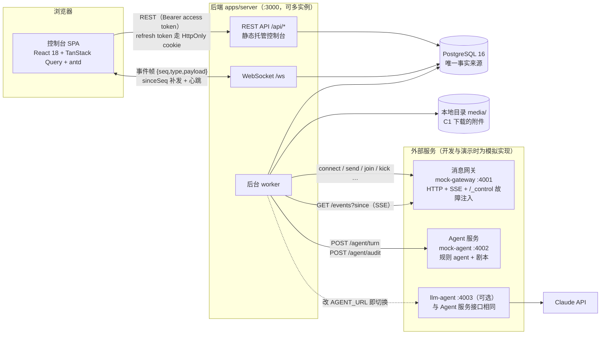

---

## 2. 后端组件

一个服务进程分四层：入口与后台 worker 并列在最上层，都只调用领域层；领域层再经基础设施访问数据库与外部服务。领域层内跨模块的状态变更只经过收口函数（见第 3 节）。

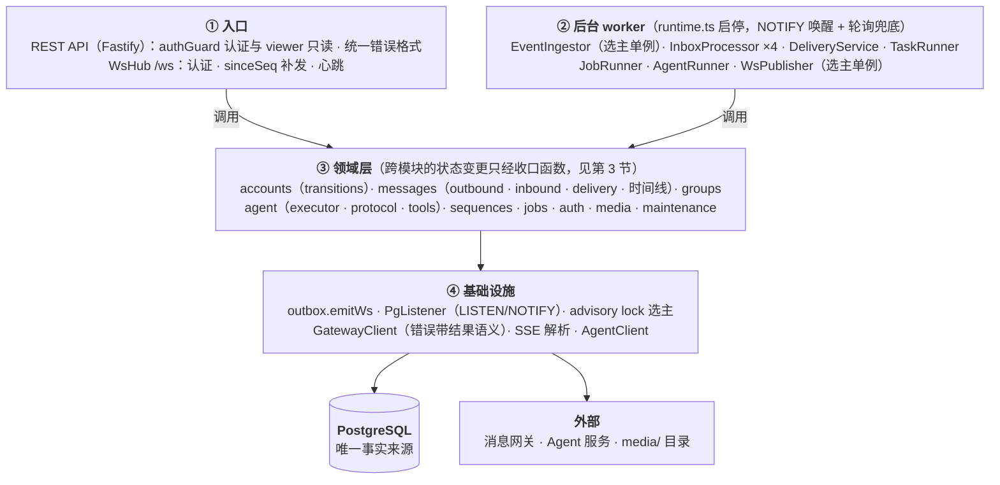

各组件的职责与依赖：

| 组件 | 读写 | 调用 |
|---|---|---|
| REST API | 领域服务 | — |
| WsHub | `ws_outbox`（按 seq 读取） | 被 PgListener 唤醒 |
| EventIngestor | `gateway_events`、`kv.event_cursor` | SSE 解析、网关 `/events` |
| InboxProcessor | 业务表（经事件处理器） | 领域层：账号、消息、成员 |
| DeliveryService | `messages` | GatewayClient：send、by-client-id |
| TaskRunner | `scheduled_tasks` | 限流到期、网关 disconnect、序列步骤、媒体、维护 |
| JobRunner | `jobs`、`groups`、`group_members` | GatewayClient：建群、邀请、join、promote、leave、members |
| AgentRunner | `agent_*`、`messages` | AgentClient、GatewayClient：kick、members |
| WsPublisher | `ws_outbox`、`ws_seq_state` | NOTIFY `ws_publish` |

| worker | 领取方式 | 运行实例 | 唤醒 |
|---|---|---|---|
| EventIngestor | advisory lock 选主 | 全局一个 | 常驻 SSE，断线退避重连 |
| InboxProcessor | `FOR UPDATE SKIP LOCKED` | 每实例 4 个并发 | NOTIFY + 轮询 |
| DeliveryService | 按账号队头 `SKIP LOCKED`，未知状态用租约 | 每实例 | NOTIFY + 100ms |
| TaskRunner | `scheduled_tasks` 租约 | 每实例 | NOTIFY + 200ms |
| JobRunner | `jobs` 租约 + 心跳 | 每实例 | NOTIFY + 250ms |
| AgentRunner | `agent_runs` 租约 + 心跳 | 每实例 | NOTIFY + 250ms |
| WsPublisher | advisory lock 选主 | 全局一个 | NOTIFY + 200ms |
| WsHub 心跳 | 本实例的连接 | 每实例 | 每 15s |

定时任务的种类：`rate_limit_expiry`（限流到期）、`gateway_disconnect`（通知网关离线）、`sequence_step`（序列当前步到点）、`media_download` / `media_cleanup`（C1）、`maintenance`（清理过期的推送事件、网关事件、吊销记录）。

---

## 3. 跨模块联动（收口函数与挂接点）

状态变更只经过三个收口函数。它们在调用方的事务里完成全部后果，所以"从任何来源进入某个状态，后果都一样，而且要么全生效要么全不生效"。

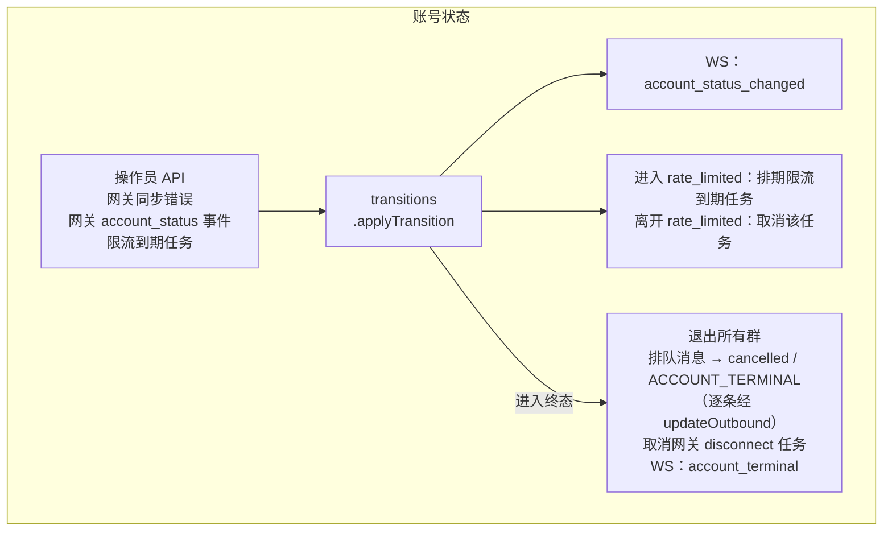

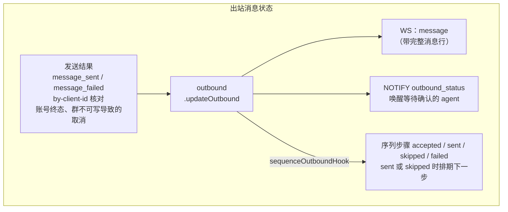

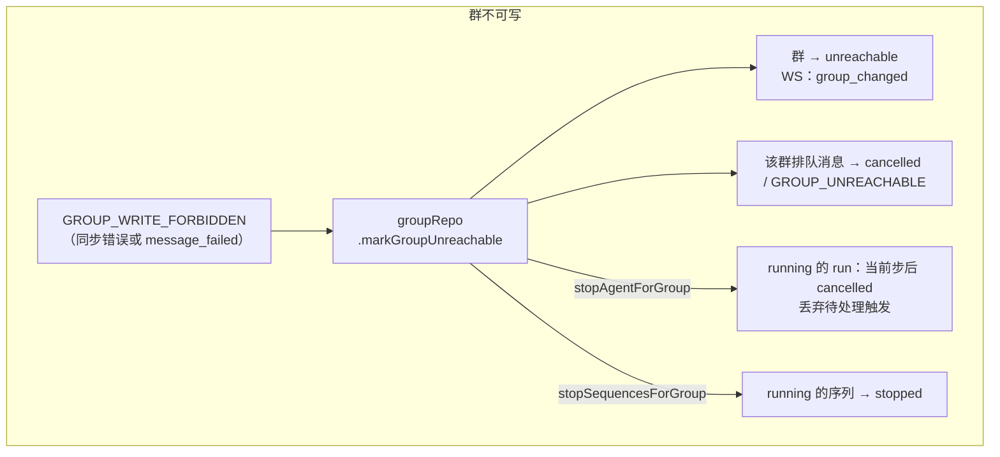

另外两个挂接点：

| 触发 | 挂接点 | 后果 |
|---|---|---|
| 存入一条非自己的新消息 | `agentTriggerHook` | 群开启 agent 且可写时写入 `agent_triggers`，作为下一次 run 的触发消息 |
| `PATCH agentEnabled=false` | `agentSettingsHook` | 与群不可写相同：run 在当前步后 cancelled，丢弃待处理触发 |

---

## 4. 多实例协调

实例之间没有直接通信，互斥与唤醒全部借助 PostgreSQL。

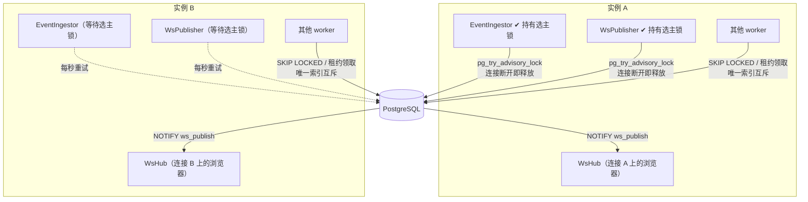

| 需要互斥的对象 | 机制 |
|---|---|
| 同一群同时只有一个 running 的 agent run | `agent_runs` 部分唯一索引 `(group_id) WHERE status='running'` |
| 同一群同时只有一个 running 的序列 | `sequence_runs` 部分唯一索引，并发启动的输家得到 409 |
| 同一群只有一个进行中的 leave-all | `jobs` 部分唯一索引 |
| 同一账号并发变更 | `SELECT … FOR UPDATE NOWAIT`，拿不到锁即 409 CAS_CONFLICT |
| 事件只存一份 | `gateway_events.event_id` 主键 |
| 一条事件、一条消息、一个任务只被一个 worker 处理 | `FOR UPDATE SKIP LOCKED`，或带到期时间的租约 |
| 重启后接手自己之前的工作 | 租约按 `INSTANCE_ID` 记录，同名实例启动后立即接手不在内存中的租约 |

---

## 5. 网关事件接入

事件先原样落库（去重），再由处理器逐条处理。续传点永远不越过尚未落库的事件；网关保留全部历史，所以停机、断流、数据库写入失败都不会丢事件。

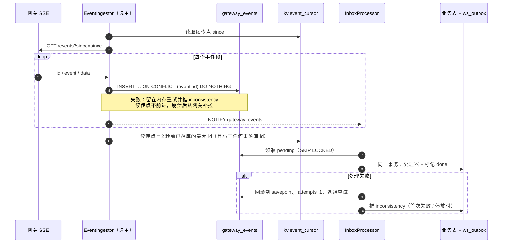

各事件处理器都与到达顺序无关，所以可以并发处理、任意重放：

| 事件 | 处理 |
|---|---|
| `message` | 按 `(group_id, msg_id)` 去重；自己账号发的先存为隐藏行，等 `message_sent` 合并；非自己的在 agent 开启时写入触发表；带附件的安排下载 |
| `message_sent` / `message_failed` | `updateOutbound`，状态只前进 |
| `member_joined` / `member_left` | 以事件 id 判断新旧，较新的胜出；终态账号不会重新出现 |
| `account_status` | 进入终态；已是终态则忽略 |

---

## 6. 出站消息发送

### 6.1 时序

受理时先写 `queued`；发请求前先提交 `dispatching`；只有在"504 之后超过 2 秒仍查不到"时才重发，且最多一次。

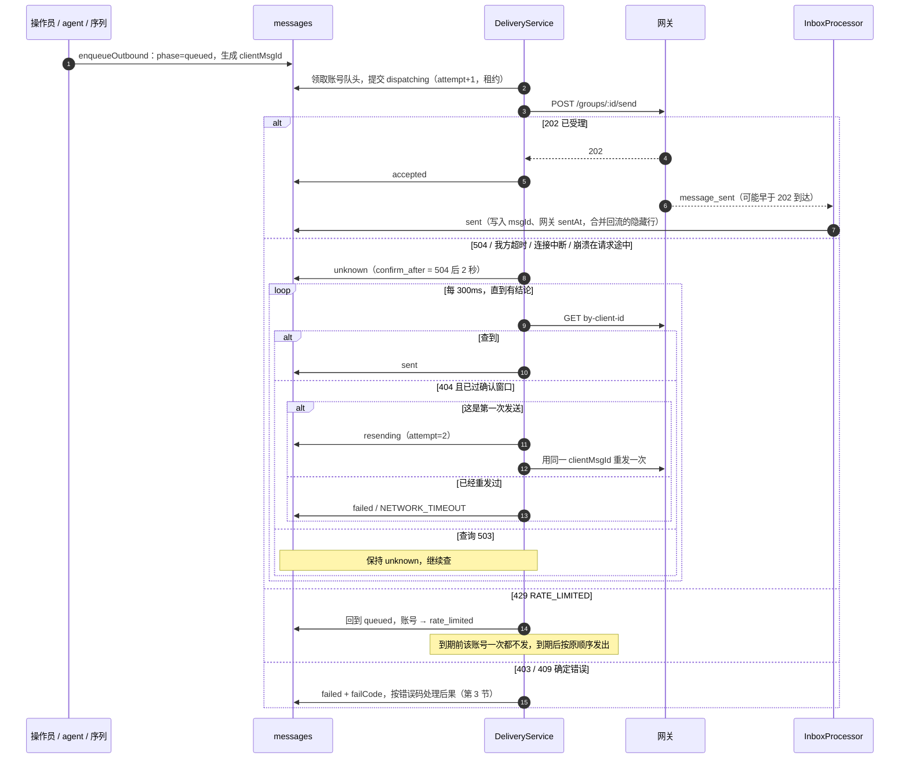

### 6.2 状态机

对外的 `deliveryStatus` 是内部阶段的投影：`dispatching` 显示为 `queued`，`resending` 显示为 `unknown`。

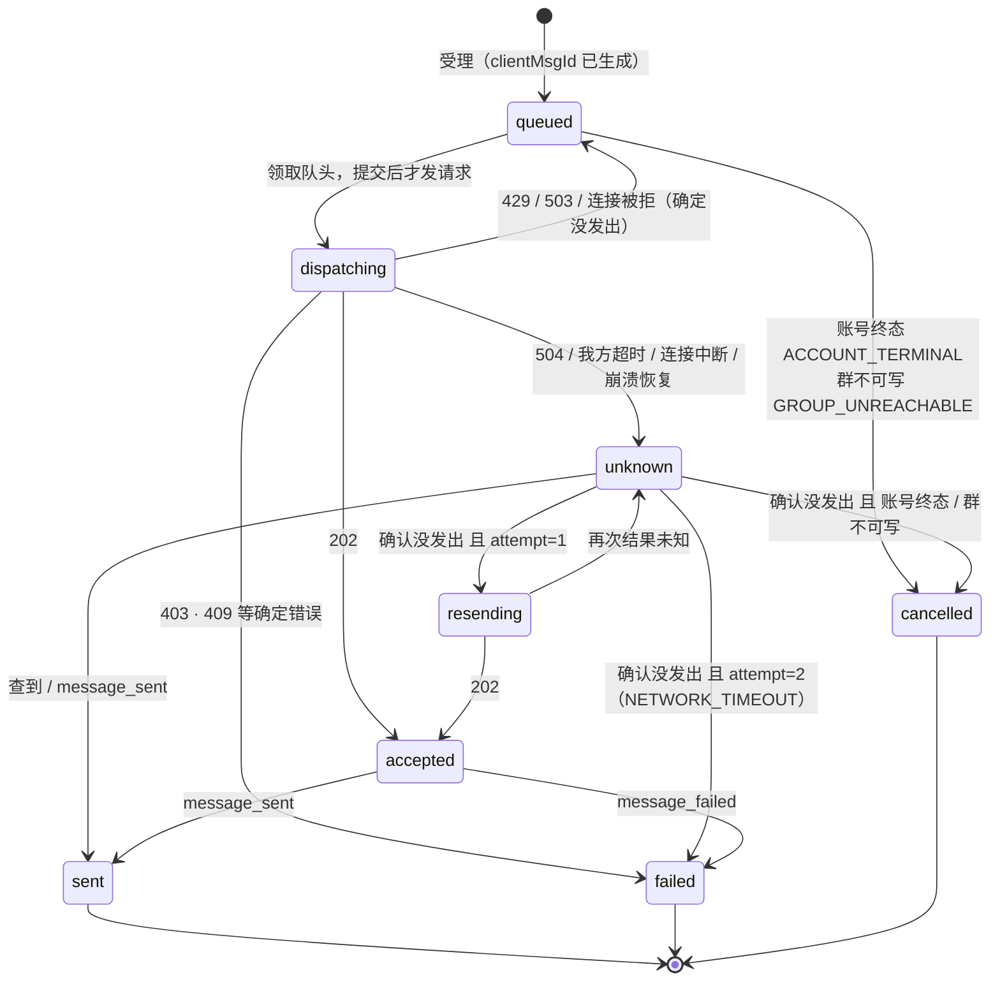

---

## 7. 账号状态机

与 `packages/shared/src/accountTransitions.ts` 中的转移表一致（前端按钮的显隐也用这张表）。终态没有出边。

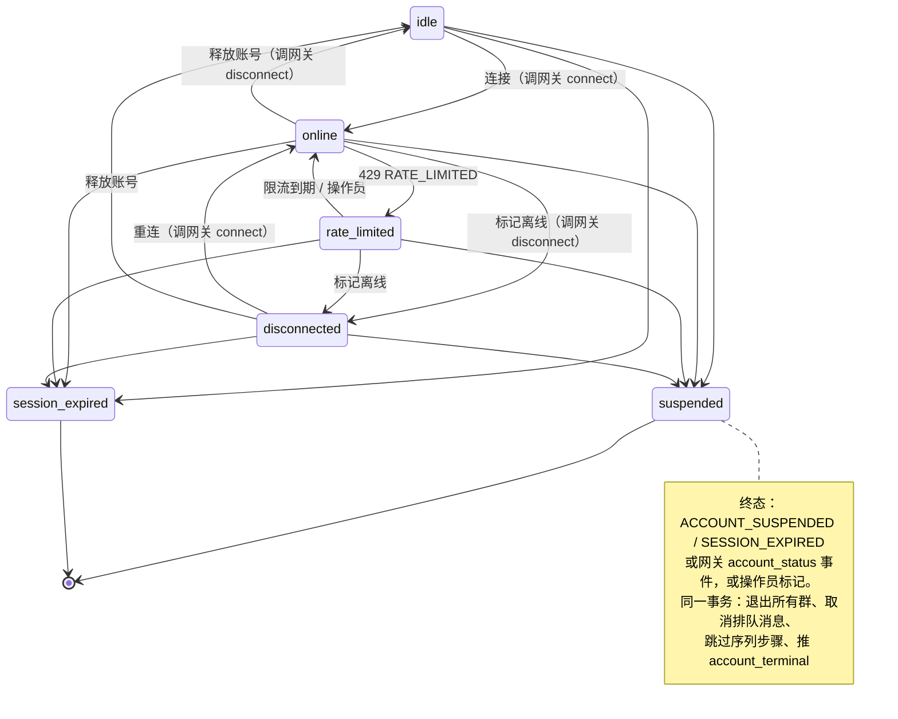

---

## 8. Agent run

### 8.1 触发

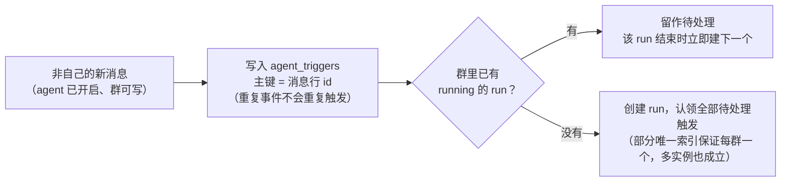

### 8.2 执行循环

一步 = 一次 `/agent/turn` 往返。每一步分两次落库：T1 记录响应与分类，T2 记录工具结果；工具的执行进度记在 `agent_tool_calls`，崩溃后按记录的阶段续跑，已生效的外部效果不会重复。

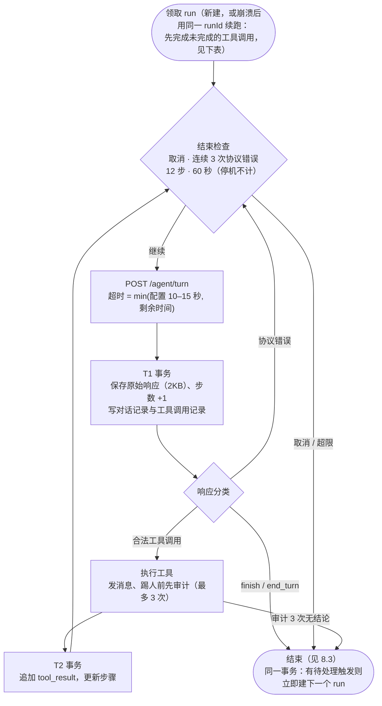

| 响应分类 | 对话记录中追加的内容 | 计入连续协议错误 |
|---|---|---|
| 合法工具调用 | assistant 的 tool_use 块，执行后追加 tool_result | 否（清零） |
| 未知工具 / 入参不合 schema | assistant 的 tool_use 块 + `is_error` 的 tool_result（`UNKNOWN_TOOL` / `INVALID_INPUT`） | 是 |
| 坏 JSON（含代码围栏、前后夹文字、形状不对）/ 重复 tool_use.id / 超时 | 一条 user 文本 `PROTOCOL_ERROR <code>: <一句话>` | 是 |
| `finish` / `end_turn` | —（run 结束，summary 取自 finish 入参或 end_turn 文本） | 否 |

崩溃发生在不同位置时的续跑方式：

| 中断位置 | 续跑时 |
|---|---|
| `/agent/turn` 请求途中 | 用同样的对话记录重新请求，不计步 |
| T1 之后、工具执行前 | 按 `agent_tool_calls.phase=pending` 执行 |
| 审计途中 | 继续审计；尝试次数已落库，总数不超过 3；已有结论不再审计 |
| 发消息已入队 | 不再审计、不新建消息，只等待该消息的状态 |
| 踢人已发出 | 先等 2 秒让网关收敛，再查成员列表；目标已不在即判为成功，否则再踢 |

### 8.3 run 状态

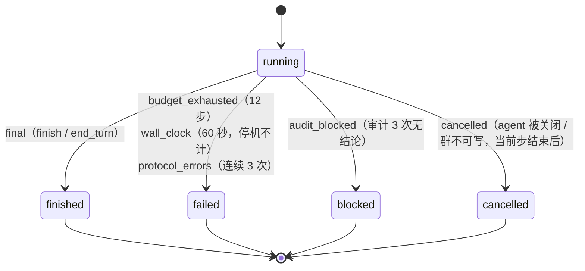

---

## 9. 定时序列

### 9.1 启动与排期

同一时刻只有"当前步"有排期（一个持久化定时任务）。下一步从上一步收到 `message_sent` 的时刻（或跳过的时刻）开始计时。

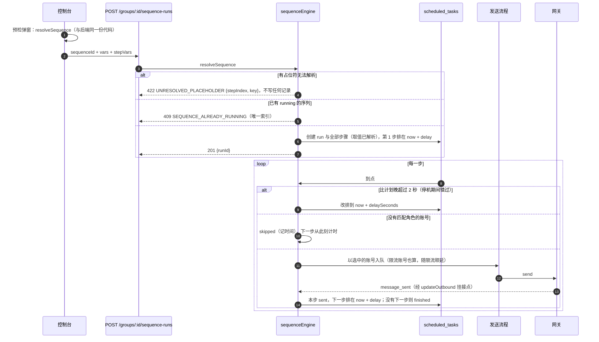

### 9.2 状态

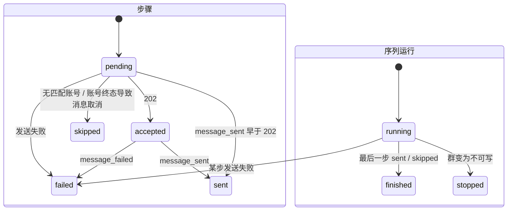

---

## 10. 建群与退群任务

任务每推进一步就把进度写进 `jobs.state`，由持租约的执行器驱动，崩溃后从断点继续。

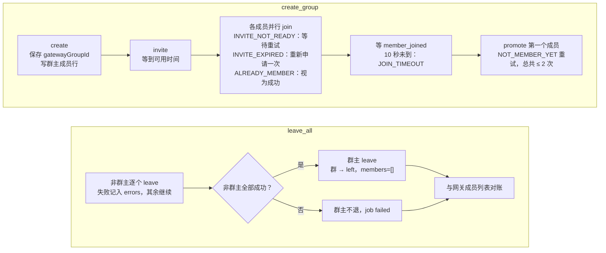

---

## 11. 实时推送

业务事务只写事件；单一发布者在提交后按顺序分配 seq，所以 seq 连续、推送的状态一定已保存，断线后按 `sinceSeq` 补发不会漏也不会重。

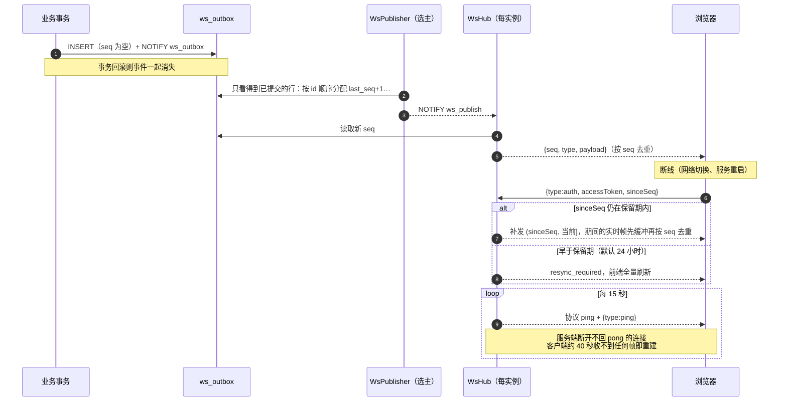

---

## 12. 数据模型

按领域拆成四张图，只列关键字段。完整定义见 `apps/server/migrations/*.sql`。

### 12.1 账号、群与消息

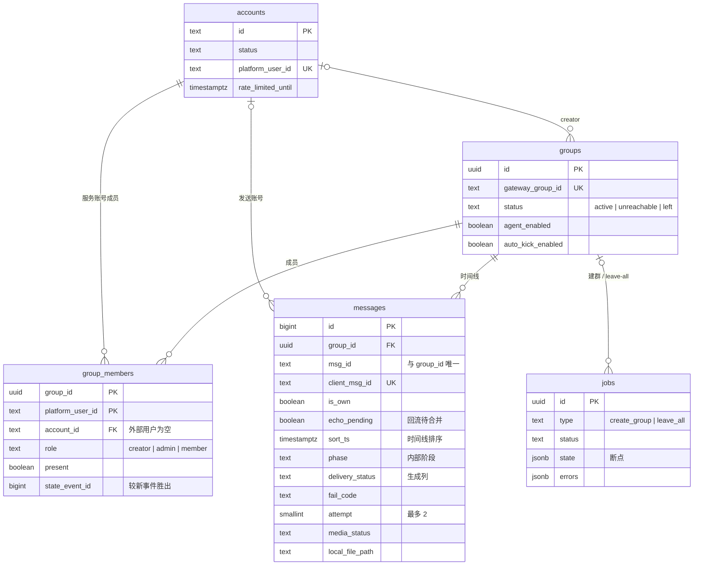

### 12.2 Agent

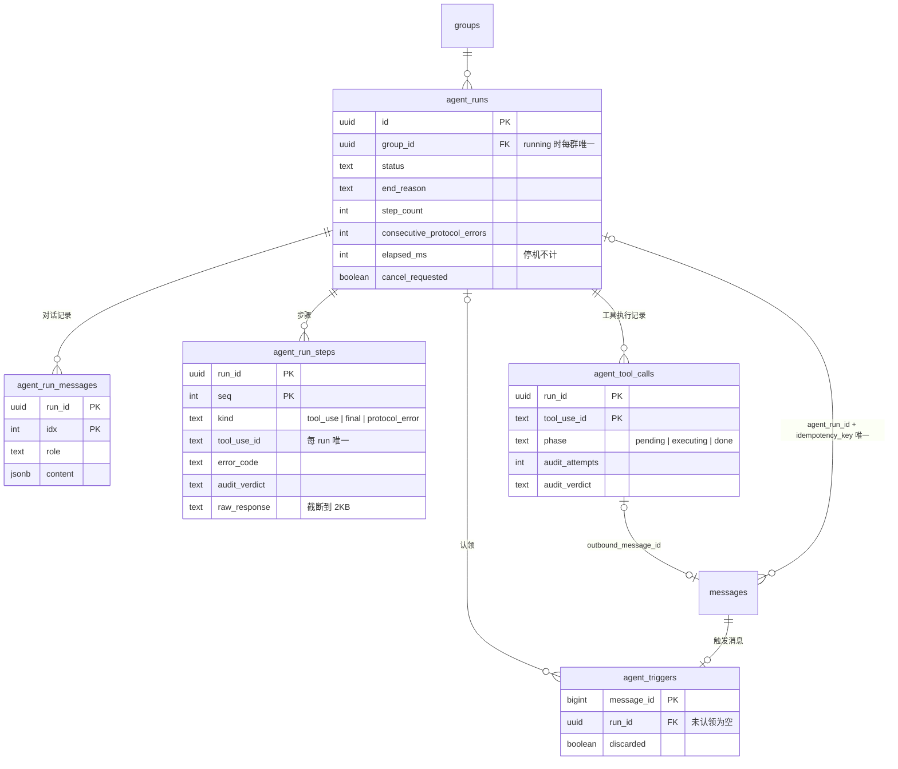

### 12.3 定时序列

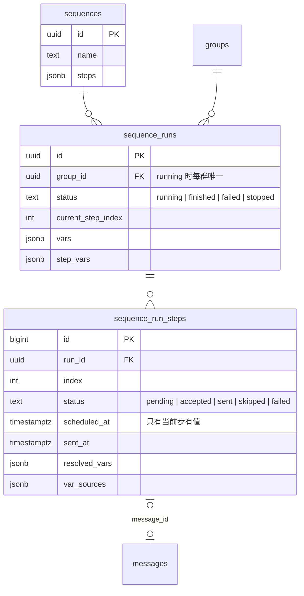

### 12.4 认证

```mermaid
erDiagram
  users ||--o{ sessions : "登录"
  sessions ||--o{ refresh_tokens : "轮换链"
  refresh_tokens |o--o| refresh_tokens : "replaced_by"

  users {
    uuid id PK
    text username UK
    text role "admin | viewer"
  }
  sessions {
    uuid id PK
    uuid user_id FK
    timestamptz revoked_at "吊销即全部 token 失效"
  }
  refresh_tokens {
    uuid id PK
    uuid session_id FK
    text token_hash UK "只存哈希"
    timestamptz used_at "重用即作废会话"
  }
  revoked_access_tokens {
    uuid jti PK
    timestamptz expires_at
  }
```

### 12.5 基础设施表

| 表 | 作用 | 关键约束 |
|---|---|---|
| `gateway_events` | 网关事件收件箱（原始帧按字节保存） | `event_id` 主键去重；`status` pending / done / failed |
| `kv` | 事件续传点等键值 | `key` 主键 |
| `scheduled_tasks` | 持久化定时任务 | `(kind, ref)` 唯一；`version` 检测执行中的重排；租约 |
| `ws_outbox` | 推送事件 | 业务事务写入；`seq` 发布时分配、唯一 |
| `ws_seq_state` | seq 计数器 | 单行 |
| `schema_migrations` | 已执行的迁移 | 版本号 + 校验和 |

---

## 13. 前端架构

```mermaid
flowchart TB
  subgraph PAGES["页面"]
    direction LR
    P1["登录"]
    P2["账号列表"]
    P3["群列表 · 群详情<br/>（时间线、成员、agent run、发消息）"]
    P4["Agent run 详情"]
    P5["序列 · 序列运行"]
  end

  subgraph STATE["状态"]
    direction LR
    AUTH["AuthProvider<br/>用户与角色（viewer 不渲染写操作）"]
    QC["TanStack Query 缓存"]
    TL["时间线状态<br/>按行 id 合并，(sentAt,id) 排序"]
  end

  subgraph NET["网络"]
    direction LR
    HC["HttpClient<br/>access token 只在内存<br/>401 → 单次 refresh（single flight）<br/>跨标签页 Web Locks + BroadcastChannel"]
    RC["RealtimeClient<br/>sinceSeq 补发 · seq 去重<br/>心跳超时重建 · online/visible 立即重连"]
  end

  SHARED["@gmp/shared<br/>DTO 类型 · 账号转移表 · resolveSequence"]
  API["/api/*"]
  WSE["/ws"]

  PAGES --> AUTH
  PAGES --> QC
  P3 --> TL
  QC --> HC --> API
  RC --> WSE
  RC -- "事件 → 失效对应查询" --> QC
  RC -- "message 事件" --> TL
  HC -- "新 token" --> RC
  P2 -. "按钮显隐" .-> SHARED
  P5 -. "预检" .-> SHARED
```

---

## 14. 登录会话

```mermaid
sequenceDiagram
  autonumber
  participant B as 浏览器
  participant API as /api/auth
  participant DB as sessions / refresh_tokens

  B->>API: POST /login
  API->>DB: 新会话 + refresh token（存哈希）
  API-->>B: {accessToken}（15 分钟）+ Set-Cookie rt（HttpOnly）
  Note over B: 请求遇到 401（access token 过期）
  B->>API: POST /refresh（cookie rt1）
  API->>DB: rt1 标记已用，签发 rt2
  API-->>B: 新 accessToken + Set-Cookie rt2
  alt 已用过的 rt1 再次出现（被盗或重放）
    B->>API: POST /refresh（cookie rt1）
    API->>DB: 吊销整个会话
    API-->>B: 401，该会话之前换出的 rt2 与所有 access token 立即失效
  end
  B->>API: POST /logout
  API->>DB: 吊销会话 + 记录 jti
  Note over API: 每个请求都校验会话与 jti，登出立即生效
```
